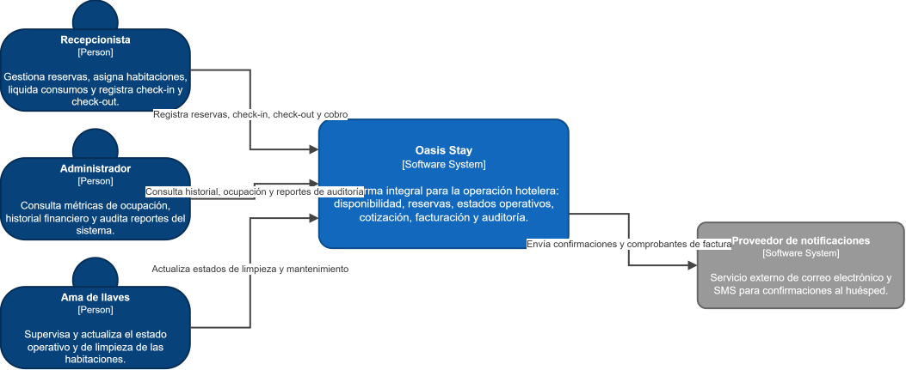
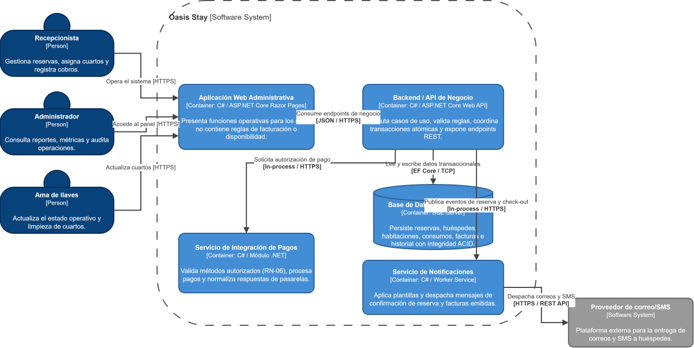
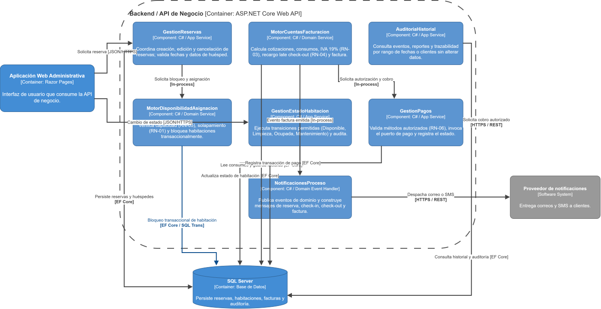

# Laboratorio - Modelo C4 para Oasis Stay

> **Paquete descargable:** El archivo con todos los diagramas y fuentes en formato comprimido está disponible en [`C4.zip`](C4.zip).

## Integrantes

- Luis Miguel Arango Garcia  
- Juan David Jimenez  
- Thomas Muñoz Cardona  
- Yeison Cardozo Gomez  
- Simon Herrera Acosta

## 1\. Comprensión del problema y trazabilidad

### Sistema modelado

Oasis Stay es una plataforma para la operación hotelera. Centraliza huéspedes, reservas, disponibilidad y asignación de habitaciones, estados operativos, consumos, cotizaciones, facturación, pagos, historial y auditoría.

El alcance arquitectónico se deriva de los requisitos, reglas de negocio, roles e historias de usuario del documento de requisitos del proyecto. La trazabilidad se expresa por capacidad de negocio para evitar que el C4 quede desconectado del trabajo previo.

| Capacidad del requisito | Resultado esperado | Roles e historias relacionadas | Elementos C4 que la soportan |
| :---- | :---- | :---- | :---- |
| Gestión de huéspedes y reservas | Registrar, consultar, editar y cancelar una reserva con datos válidos, fechas y huéspedes asociados. | Recepcionista; historias de registro y actualización de reserva. | `GestionReservas`, `MotorDisponibilidadAsignacion`, `RepositorioReservas` y `RepositorioHuespedes`. |
| Disponibilidad y asignación | Evitar sobreasignación y doble reserva; asignar una habitación compatible con capacidad y fechas. | Recepcionista; historias de consulta de disponibilidad y asignación. | `MotorDisponibilidadAsignacion`, `RepositorioHabitaciones` y transacción de base de datos. |
| Operación de habitaciones | Mantener estados Disponible, Reservada, Ocupada, En limpieza y Mantenimiento. | Ama de llaves y recepcionista; historias de cambio de estado, check-in y check-out. | `GestionEstadoHabitacion`, `RegistroAuditoria` y `RepositorioHabitaciones`. |
| Cotización y cuenta | Calcular noches, consumos adicionales, impuestos, cargos y total antes del cierre. | Recepcionista; historias de cotización y consulta de cuenta. | `MotorCuentasFacturacion`, `CalculadoraCuenta`, políticas de dominio e `ItemCobro`. |
| Facturación y pago | Emitir la factura, validar el método de pago autorizado (efectivo, voucher de tarjeta o transferencia) y registrar el cobro (RN-06). | Recepcionista; historias de cierre de cuenta y confirmación de pago. | `FacturacionService`, `GestionPagos`, `FacturaRepository` y `RepositorioPagos`. |
| Notificaciones | Enviar confirmaciones de reserva, check-in, check-out y factura emitida. | Huésped como destinatario; historias de confirmación y cierre. | `NotificacionesProceso` y proveedor externo de correo/SMS. |
| Administración, historial y auditoría | Consultar operación por rango, estado o cliente y conservar trazabilidad de cambios. | Administrador; historias de administración, reportes y auditoría. | `AuditoriaHistorial`, repositorios y `RegistroAuditoria`. |

### Decisiones iniciales del equipo

| Elemento | Decisión |
| :---- | :---- |
| Responsabilidad principal | Orquestar el ciclo de reserva desde el registro hasta el check-out, con cálculo automático de cuenta, factura, pago e historial. |
| Actores principales | Recepcionista, Administrador y Ama de llaves. |
| Sistemas externos | Proveedor de notificaciones (correo o SMS) y servicio de generación de PDF. Los pagos se gestionan internamente mediante registro de vouchers y comprobantes (RN-06). |
| Información administrada | Huéspedes, reservas, habitaciones, estados operativos, consumos, facturas, pagos, historial y auditoría. |
| Regla de asignación | `MotorDisponibilidadAsignacion` es el único componente que bloquea una habitación dentro de una transacción; `GestionReservas` coordina el caso de uso. |
| Decisión de pagos | En el MVP, la integración de pagos puede desplegarse como módulo del backend. Se conserva un puerto/adaptador para extraerla a un contenedor independiente cuando seguridad, cumplimiento o escala lo requieran. |

### Límite de responsabilidad

Oasis Stay es responsable de:

- Validar reglas del hotel: no sobreasignación, capacidad máxima, fechas, estados válidos, IVA, late check-out y métodos autorizados.  
- Persistir datos operativos, resultados de pago y trazabilidad.  
- Exponer las funciones para los roles internos.  
- Solicitar capacidades externas mediante contratos explícitos.

Quedan fuera del dominio de Oasis Stay:

- La verificación interbancaria en línea (diferida a Release 2; el MVP valida los datos de autorización del voucher o comprobante ingresados por recepción).  
- La entrega efectiva de correo o SMS.  
- La representación física del documento PDF.

## 2\. C4 Nivel 1 \- Contexto

### Diagrama

- Enlace directo a Draw.io web: [Abrir Nivel 1 en diagrams.net](https://n9.cl/wpuzv)

### Explicación

Oasis Stay es el sistema central. El Recepcionista gestiona reservas, check-in, check-out, cotizaciones y pagos; el Administrador administra catálogos, usuarios, reportes y auditoría; y el Ama de llaves actualiza el estado operativo de las habitaciones. El sistema valida y registra el cobro según el método seleccionado (RN-06) y despacha las confirmaciones al proveedor de notificaciones.

La base de datos no aparece como actor ni como sistema externo en este nivel: es un detalle interno del despliegue que se introduce en el Nivel 2\.

## 3\. C4 Nivel 2 \- Contenedores

### Contenedores

| Contenedor | Responsabilidad | Tecnología propuesta | Interfaces y comunicación |
| :---- | :---- | :---- | :---- |
| Aplicación Web Administrativa | Presentar las funciones para los tres roles y consumir la API. No contiene reglas de disponibilidad o facturación. | ASP.NET Core Razor Pages, HTML, CSS y JavaScript. | HTTPS/REST hacia el Backend/API. |
| Backend/API de Negocio | Ejecutar casos de uso, validar reglas, coordinar transacciones, auditoría y eventos de proceso. | C\# y ASP.NET Core Web API. | REST interno; EF Core hacia SQL Server; HTTPS hacia integraciones. |
| Base de Datos Transaccional | Persistir reservas, huéspedes, habitaciones, consumos, facturas, pagos e historial con consistencia. | SQL Server. | Acceso exclusivo desde el backend mediante EF Core. |
| Servicio de Notificaciones | Consumir eventos y aplicar plantillas; no calcula cuentas ni decide estados de reserva. | Servicio HTTP o worker con proveedor de correo/SMS. | HTTPS/API hacia el proveedor externo. |
| Registro de Pagos | Validar los datos del cobro (efectivo, voucher de datáfono o referencia de transferencia) y registrar la transacción con consistencia transaccional (RN-06). | Módulo del backend en C\# / .NET. | In-process desde el Backend/API; EF Core hacia SQL Server. |

### Diagrama

- Enlace directo a Draw.io web: [Abrir Nivel 2 en diagrams.net](https://n9.cl/4t8frk)

### Explicación y decisiones de despliegue

La Aplicación Web no accede directamente a SQL Server: toda operación pasa por la API, que concentra autorización, reglas y transacciones. El backend es el límite de consistencia de la reserva y de la cuenta.

En el MVP, el Registro de Pagos opera como módulo interno del Backend, encapsulando las validaciones de los métodos autorizados (RN-06) sin dependencias de servicios bancarios externos. A futuro (Release 2), esta arquitectura desacoplada permitirá integrar pasarelas de pago reales sin alterar el resto del sistema.

## 4\. C4 Nivel 3 \- Componentes

### Contenedor seleccionado

**Backend/API de Negocio.**

### Componentes internos

| Componente | Responsabilidad | Dependencias principales |
| :---- | :---- | :---- |
| `GestionReservas` | Crear, editar y cancelar reservas; validar huésped y fechas; coordinar disponibilidad. | `RepositorioReservas`, `RepositorioHuespedes`, `MotorDisponibilidadAsignacion`, `NotificacionesProceso`. |
| `MotorDisponibilidadAsignacion` | Consultar rangos, verificar capacidad, bloquear y asignar una habitación en una transacción. | `RepositorioHabitaciones`, `RepositorioReservas`, unidad transaccional. |
| `GestionEstadoHabitacion` | Ejecutar cambios de estado permitidos y registrar la trazabilidad. | `RepositorioHabitaciones`, `RegistroAuditoria`. |
| `MotorCuentasFacturacion` | Calcular cotización, consumos, impuestos, recargos y coordinar la emisión de factura. | `RepositorioConsumos`, `FacturaRepository`, `GestionPagos`, políticas de dominio. |
| `GestionPagos` | Validar los datos requeridos del método autorizado (efectivo, voucher o transferencia) y registrar el cobro en base de datos. | `RepositorioPagos`, `SQL Server`. |
| `AuditoriaHistorial` | Consultar eventos y operaciones por rango, estado o cliente sin modificar la información operativa. | `RepositorioReservas`, `FacturaRepository`, `RepositorioAuditoria`. |
| `NotificacionesProceso` | Publicar eventos y construir mensajes de reserva, check-in, check-out y factura. | `PuertoNotificacion`; no contiene reglas de cálculo. |

### Diagrama

- Enlace directo a Draw.io web: [Abrir Nivel 3 en diagrams.net](https://n9.cl/8r1237)

### Reglas de responsabilidad

1. `GestionReservas` orquesta; no bloquea habitaciones directamente.  
2. `MotorDisponibilidadAsignacion` es el único dueño del bloqueo transaccional, evitando carreras y doble asignación.  
3. `MotorCuentasFacturacion` calcula mediante políticas; no genera el PDF.  
4. `GestionPagos` valida y registra los cobros locales (RN-06); la verificación de vouchers físicos recae en la recepcionista y queda registrada en auditoría (RF-07, RF-10).  
5. `NotificacionesProceso` reacciona a eventos; no valida ni cambia la cuenta.  
6. `AuditoriaHistorial` consulta y registra trazas, pero no replica las reglas de reservas o facturación.

## 5\. C4 Nivel 4 \- Código y Patrones de Diseño GoF

### Componentes y Patrones Implementados

El Nivel 4 representa el modelo de clases detallado del sistema **Oasis Stay**, integrando las clases de dominio originales con los **5 patrones de diseño GoF** aprobados en la plantilla institucional del ITM para el MVP (Release 1):

1. **State (Comportamiento \- Habitaciones):** Desacopla el ciclo de vida y las reglas de transición de la habitación (EstadoDisponible, EstadoReservada, EstadoOcupada, EstadoEnLimpieza, EstadoMantenimiento), eliminando estructuras switch/if repetidas en controladores.  
2. **Decorator (Estructural \- Facturación):** Permite la liquidación dinámica de la cuenta en capas: estadía base \+ consumos variables (minibar) \+ recargo fijo por late check-out (\$40.000 COP, RN-04) \+ impuesto IVA del 19% sobre el subtotal acumulado (RN-03).  
3. **Strategy (Comportamiento \- Pagos):** Aísla los algoritmos de validación y registro para cada método de pago permitido (Efectivo, Tarjeta, Transferencia, RN-06) bajo una interfaz común (IEstrategiaPago), cumpliendo con OCP y DIP.  
4. **Facade (Estructural \- Check-Out Unificado):** Expone un punto de entrada simplificado (ICheckoutFacade / CheckoutFacade) que orquesta atómicamente el cierre de cuenta, la liberación de la habitación (a EnLimpieza) y el registro en HistorialReserva.  
5. **Chain of Responsibility (Comportamiento \- Reservas):** Secuencia las reglas de negocio obligatorias para confirmar una reserva (ValidadorFechas → ValidadorCapacidad \[RN-05\] → ValidadorEstadoHabitacion → ValidadorSolapamiento \[RN-01\]), cortando el proceso en el primer fallo.

### Elementos de código y Trazabilidad

| Patrón GoF | Elemento / Clase | Tipo | Responsabilidad y Regla Asociada | Trazabilidad |
| :---- | :---- | :---- | :---- | :---- |
| **State** | IEstadoHabitacion | Interfaz de estado | Contrato de operaciones dependientes del estado (Reservar, CheckIn, CheckOut, Limpieza). | RF-02, US-02 |
| **State** | EstadoDisponible | ConcreteState | Permite reservas directas, check-in o envío a mantenimiento preventivo. | RF-01, RF-02 |
| **State** | EstadoReservada | ConcreteState | Permite check-in para ocupar o cancelación con liberación inmediata. | RF-03, RN-02 |
| **State** | EstadoOcupada | ConcreteState | Permite check-out para liberar hacia limpieza tras liquidar. | RF-06, US-06 |
| **State** | EstadoEnLimpieza | ConcreteState | Impide asignaciones hasta que el ama de llaves marca disponible. | RF-02, US-02 |
| **State** | EstadoMantenimiento | ConcreteState | Bloquea la habitación para reparaciones hasta marcar disponible. | RF-02 |
| **Decorator** | ICuenta | Component | Contrato base para calcular el costo de la cuenta del huésped. | RF-05, US-05 |
| **Decorator** | EstadiaBase | ConcreteComponent | Calcula el alojamiento base (noches × tarifa de TipoHabitacion). | RF-05, US-05 |
| **Decorator** | CuentaDecorator | Decorador abstracto | Envuelve una instancia de ICuenta delegando el cálculo base. | RF-05, US-05 |
| **Decorator** | CargoMinibar | ConcreteDecorator | Suma cargos por consumos adicionales reportados durante la estadía. | RF-05, US-05 |
| **Decorator** | CargoLateCheckout | ConcreteDecorator | Añade el recargo fijo de \$40.000 COP cuando la salida es tardía (RN-04). | RN-04, RF-05 |
| **Decorator** | ImpuestoIVA | ConcreteDecorator | Aplica el 19% de IVA como capa externa sobre el subtotal acumulado (RN-03). | RN-03, RF-05 |
| **Strategy** | IEstrategiaPago | Interfaz de estrategia | Contrato para procesar pagos y validar datos específicos del método. | RF-10, US-10 |
| **Strategy** | ProcesadorPagos | Contexto de estrategia | Delega la ejecución del cobro a la estrategia inyectada o seleccionada. | RF-10, RN-06 |
| **Strategy** | PagoEfectivo | ConcreteStrategy | Valida dinero recibido y calcula el cambio correspondiente en caja física. | RF-10, RN-06 |
| **Strategy** | PagoTarjeta | ConcreteStrategy | Valida franquicia y código de autorización del datáfono físico (RN-06). Método: `ValidarDatosTarjeta()`. | RF-10, RN-06 |
| **Strategy** | PagoTransferencia | ConcreteStrategy | Registra y valida referencia del comprobante de transferencia bancaria institucional (RN-06). Método: `RegistrarComprobante()`. | RF-10, RN-06 |
| **Facade** | ICheckoutFacade | Interfaz de fachada | Punto unificado para que la UI de Recepción ejecute la salida del huésped. | RF-06, US-06 |
| **UI / Pres.** | Facturacion.cshtml.cs | PageModel / View | Vista Razor de facturación y salida; depende de `ICheckoutFacade` vía Inyección de Dependencias (DIP) para ejecutar `ProcesarSalida`. | RF-06, US-06 |
| **Facade** | CheckoutFacade | Fachada concreta | Orquesta transaccionalmente: facturación, liberar cuarto e historial. Depende de interfaces (`IServicioFacturacion`, `IServicioHabitacion`, `IRepositorioHistorial`) cumpliendo DIP y SRP. | RF-06, US-06 |
| **Auditoría / DIP** | IRepositorioHistorial | Interfaz de repositorio | Contrato de persistencia para archivar y auditar reservas; desacopla `CheckoutFacade` de la implementación concreta `HistorialReserva` (DIP). | RF-06, RF-07, US-06 |
| **Chain** | SolicitudReserva | DTO / Contexto | Transporta huésped, fechas, habitación y cantidad de personas. | RF-03, RF-04 |
| **Chain** | ValidadorReserva | Manejador base | Encadena el siguiente validador y despacha la solicitud en orden. | RF-03, RF-04 |
| **Chain** | ValidadorFechas | ConcreteHandler | Verifica que fecha fin sea posterior a fecha inicio y fechas válidas. | RF-03, US-03 |
| **Chain** | ValidadorCapacidad | ConcreteHandler | Verifica que número de personas no exceda la capacidad máxima (RN-05). | RN-05, RF-04 |
| **Chain** | ValidadorEstadoHab | ConcreteHandler | Verifica que la habitación se encuentre en estado DISPONIBLE. | RF-04, US-04 |
| **Chain** | ValidadorSolap | ConcreteHandler | Comprueba la ausencia de cruce de fechas con reservas activas (RN-01). | RN-01, RF-04 |

### Diagrama

- Enlace directo a Draw.io web: [Abrir Nivel 4 en diagrams.net](https://n9.cl/otd5k)

### Evidencia de coherencia

- El **Nivel 1** define las necesidades globales de clientes, recepcionistas, ama de llaves y administrador.  
- El **Nivel 2** distribuye estas responsabilidades en los contenedores Web Razor Pages, Backend API y Base de Datos SQL Server.  
- El **Nivel 3** organiza los módulos y componentes del backend: disponibilidad, reservas, facturación, pagos y auditoría.  
- El **Nivel 4** detalla el diseño orientado a objetos y los 5 patrones GoF, donde cada patrón atiende de forma directa e independiente una regla de negocio del MVP (RN-01, RN-02, RN-03, RN-04, RN-05, RN-06) sin generar sobreingeniería ni redundancia.

## 6\. Uso y validación de IA

### Prompt utilizado

Estamos desarrollando un modelo C4 para Oasis Stay con requisitos funcionales, no funcionales, roles e historias de usuario. Revisa la coherencia entre los niveles de contexto, contenedores, componentes y código. Señala elementos ubicados en un nivel incorrecto, responsabilidades mezcladas, componentes que parecen clases, dependencias innecesarias e inconsistencias con las reglas de reservas, disponibilidad, facturación, pagos, auditoría y notificaciones. No reconstruyas el modelo completo; actúa como revisor arquitectónico y explica cada hallazgo.

### Observaciones y decisiones

| Observación | Decisión | Justificación |
| :---- | :---- | :---- |
| La integración de pagos puede parecer un contenedor aunque en el MVP sea un módulo. | Parcialmente aceptada. | Se conserva como contenedor lógico y como módulo desplegable del backend en el MVP; el puerto/adaptador permite extraerla por seguridad o cumplimiento. |
| Notificaciones no debe contener reglas de facturación. | Aceptada. | Solo consume eventos, selecciona plantillas y solicita el envío al proveedor. |
| El PDF no debe mezclarse con el cálculo. | Aceptada. | `FacturaPdfGenerator` pertenece a infraestructura y recibe una factura ya cerrada. |
| No estaba claro quién bloqueaba una habitación y el diagrama Nivel 3 omitía la conexión a BD desde el motor de asignación. | Aceptada y corregida. | `MotorDisponibilidadAsignacion` realiza el bloqueo transaccional; se agregó explícitamente su relación con `SQL Server` mediante EF Core / Transacción. |
| La base de datos aparecía implícitamente como actor de contexto. | Corregida. | SQL Server se muestra por primera vez en el Nivel 2 como contenedor de persistencia. |
| Faltaban los límites punteados (System Boundary y Container Boundary) y los metadatos de tipos y protocolos requeridos por la guía docente (C4 estándar). | Aceptada y corregida. | Se agregaron los límites punteados en los Niveles 2 y 3, metadatos (`[Person]`, `[Software System]`, `[Container]`, `[Component]`) y protocolos explícitos en las relaciones (`[HTTPS]`, `[JSON/HTTPS]`, `[EF Core]`, `[In-process]`). |
| Los estereotipos de interfaces en el Nivel 4 aparecían como `<>` por errores de marcado. | Corregida. | Se corrigió la notación UML a `<<interface>>`, `<<application service>>` y `<<domain rule>>` con visibilidad y multiplicidades estándar. |

## 7\. Auditoría final de coherencia

| Transición | Verificación |
| :---- | :---- |
| Requisitos \-\> Nivel 1 | Cada capacidad del negocio tiene actor, sistema o sistema externo asociado. |
| Nivel 1 \-\> Nivel 2 | La Web, API, persistencia y adaptadores explican cómo se realiza cada interacción del contexto. |
| Nivel 2 \-\> Nivel 3 | Los componentes están dentro del Backend y no se presentan como contenedores desplegables. |
| Nivel 3 \-\> Nivel 4 | Los componentes de Nivel 3 (habitaciones, reservas, facturación, pagos y auditoría) se materializan en las clases de dominio y los 5 patrones GoF aprobados (State, Decorator, Strategy, Facade, Chain of Responsibility). |
| Diagramas \-\> fuentes editables | Cada nivel tiene una imagen para la entrega y una fuente editable enlazada en el repositorio. |
| Requisitos no funcionales | La API centraliza autorización y reglas; SQL Server garantiza consistencia transaccional; las integraciones usan HTTPS; auditoría conserva trazabilidad; los adaptadores permiten evolución y escalamiento. |

## 8\. Conclusiones

1. **Sistema:** solución completa y frontera de negocio de Oasis Stay.  
2. **Contenedor:** aplicación o almacén desplegable dentro del sistema.  
3. **Componente:** módulo funcional dentro de un contenedor.  
4. **Elemento de código:** clase, interfaz, entidad, política o adaptador que implementa un componente.

La transición más difícil fue de Nivel 2 a Nivel 3, porque fue necesario separar responsabilidades sin convertir entidades de dominio en componentes arquitectónicos. La evidencia de coherencia está en la trazabilidad de reservas, habitaciones, facturación, pagos, notificaciones y auditoría desde los requisitos hasta las clases del Nivel 4\.