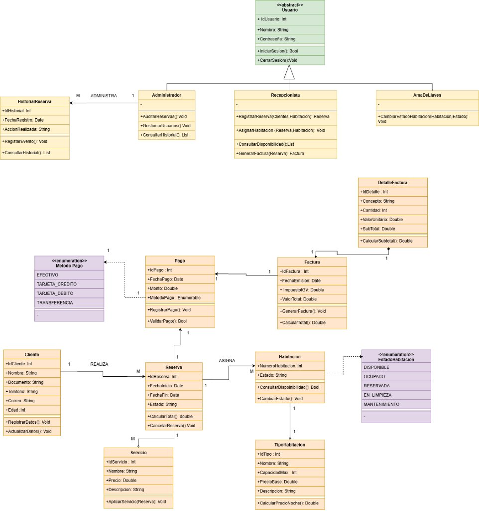

# Diagrama de Clases — Proyecto Oasis Stay

En este directorio se encuentra el modelo estructural y diagrama de clases de **Oasis Stay**, diseñado para representar las entidades del dominio hotelero, sus atributos, métodos y relaciones.

---

## 1. Enlace al Diagrama Editable

Puedes consultar y editar el diagrama interactivo directamente en diagrams.net (Draw.io) a través del siguiente enlace:

🔗 **[Abrir Diagrama de Clases en diagrams.net](https://n9.cl/3acor9)**

URL completa:
```text
https://n9.cl/3acor9
```

---

## 2. Vista Previa del Diagrama



---

## 3. Descripción de Entidades y Arquitectura

El modelo de clases define los elementos fundamentales de la lógica de negocio:

### Usuarios y Roles
- **`Usuario` (Abstracta):** Clase base con atributos comunes (`IdUsuario`, `Nombre`, `Contraseña`) y comportamiento de autenticación (`IniciarSesion()`, `CerrarSesion()`).
  - **`Administrador`:** Encargado de auditar reservas, gestionar usuarios del sistema y consultar el historial completo.
  - **`Recepcionista`:** Gestiona el ciclo operativo: registro de reservas, asignación de habitaciones disponibles, consulta de disponibilidad y emisión de facturas.
  - **`AmaDeLlaves`:** Encargada del mantenimiento y actualización de estados operativos de las habitaciones (`CambiarEstadoHabitacion`).

### Gestión Hotelera
- **`Cliente`:** Almacena los datos personales del huésped (`Nombre`, `Documento`, `Telefono`, `Correo`, `Edad`) con métodos de registro y actualización.
- **`Reserva`:** Asocia un cliente con una o más habitaciones y servicios adicionales en un rango de fechas (`FechaInicio`, `FechaFin`), calculando el valor total de la estancia o permitiendo su cancelación.
- **`Habitacion`:** Modela cada unidad física con su número, estado operativo y tipo.
  - **`TipoHabitacion`:** Define categoría, capacidad máxima, precio base por noche y descripción.
  - **`EstadoHabitacion` (Enumeración):** `DISPONIBLE`, `OCUPADO`, `RESERVADA`, `EN_LIMPIEZA`, `MANTENIMIENTO`.
- **`Servicio`:** Servicios adicionales ofrecidos por el hotel aplicables a la reserva.

### Facturación y Pagos
- **`Factura` & `DetalleFactura`:** Generación del comprobante con cálculo de impuestos (IVA), desglose de ítems/conceptos consumidos y valor total.
- **`Pago`:** Registra y valida el cobro asociado a una factura.
  - **`MetodoPago` (Enumeración):** `EFECTIVO`, `TARJETA_CREDITO`, `TARJETA_DEBITO`, `TRANSFERENCIA`.

### Auditoría
- **`HistorialReserva`:** Registro inmutable de eventos, fecha y acciones realizadas sobre las reservas para fines de auditoría administrativa.
