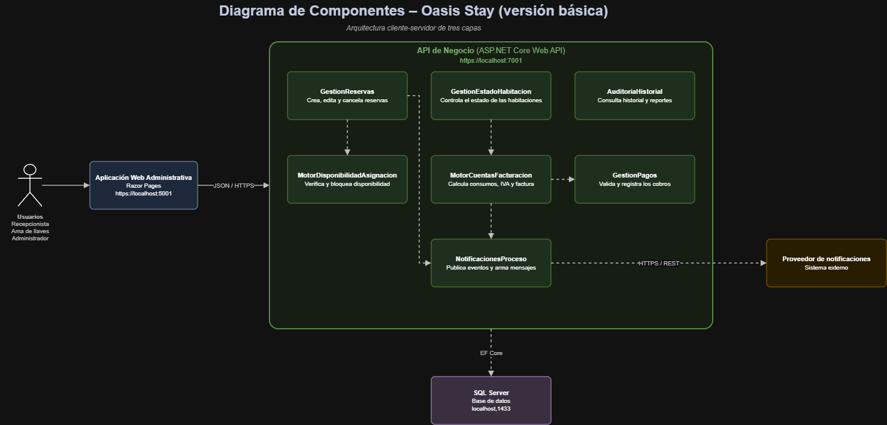
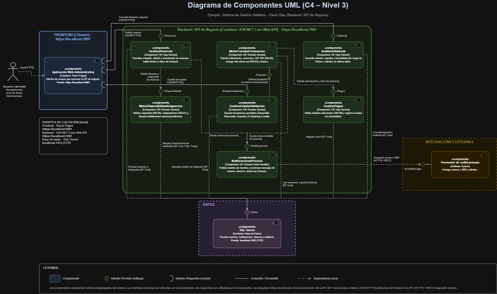

## 1. DESCRIPCION BREVE DE LA ARQUITECTURA UTILIZADA

Oasis Stay es un sistema de gestion hotelera con una arquitectura muy conocida entre cliente-servidor la cual esta compuesta por tres capas: presentacion (front) la cual sera implementada con la tecnologia .Net (razor pages), logica de negocio (api) la cual sera creada por nosotros mismo con la tecnologia de ASP.NET Core Web API (C#) y los datos (base de datos) la cual sera implementada en SQL Server. Este sistema es utilizado por tres roles: recepcionista, ama de llaves y administrador. Cada uno opera la aplicación según sus funciones (reservas, estado de las habitaciones, facturacion y reportes).

La comunicación entre capas seria median JSON sobre HTTPS, y ya la API accede a la base de datos con el framework a utilizar que seria Entity Framework Core.

La organización de la API por dentro es bastante sencilla ya que esta organizada como un monolito modular con componentes separados (reservas, estados de habitaciones, disponibilidad, facturacion, pagos, notificaciones y auditoria).

La unica integracion externa que se va a realizar en el programa seria las de las notificaciones al momento de realizar el pago y estas se harian mediante correo y SMS.

## 2. COMPONENTES Y RESPONSABILIDADES

**Reservas:** Crear, editar y cancelar reservas

- Validar fechas y datos del huesped
- Guardar la reserva y publicar el evento de la reserva

**EstadoHabitacion:** Realiza acciones basicas y fundamentales de sus estados disponible, reservada, ocupada en limpieza

**Historial:** Guarda todos los movimientos realizados en el programa

- Ayuda a consultar acciones realizadas con anterioridad
- Ayuda con el manejo de las consultas

**Disponibilidad:** Verifica la capacidad y las fechas

- Bloque las habitaciones para reservas dobles

**Facutacion:** Calcula cotizaciones y consumos realizados por el cliente aplicando un pocentaje de IVA, teniendo en cuenta un late check-out u otros imprevistos

**Pagos:** Valida que el metodo de pago a realizar este autorizado

- Registra los pagos con trazabilidad

**Notificaciones:** Recibe los eventos realizados de reserva en el check-in, check-out y factura

- Genera los mensajes y los envia al usuario

**Aplicación web:** Es la interfaz por la cual la recepcionista, la ama de llaves y el administrador van a interactuar. Envia las peticiones a la API y muestra los resultados de las mismas

**SQL Server:** Guarda reservas, habitaciones, facturas, cobros y la auditoria, solo la API tiene acceso a ella.

## 3. DIAGRAMA INICIAL REALIZADO SIN IA

## 4. PROMPT UTILIZADO Y RESPUESTA DE LA IA

**Prompt:** Estoy implementando un diagrama de componentes para un trabajo de la universidad, en este quiero que utilices correctamente la estructura planteada por la profesora, quiero que añades correctamente los modulos ya bien definidos y todo quede completamente alineado con el diagrama 3 del c4 que te voy a pasar en unos instantes, quiere tambien que revises si la estructura compartida por las dos partes si cumple totalmente una logica bien implementada y listo.

**Respuesta:** Ya apliqué los cambios sobre tu archivo .drawio original. Ahora hago una revisión visual rápida para comprobar que nada se superponga.

Te dejo diagrama_componentes_oasis_stay_c4.drawio. Es tu mismo archivo con los cambios aplicados encima, así que conserva la estructura: las zonas (Frontend, Backend, Datos, Integraciones), los componentes con su ícono, las interfaces (lollipop y socket), las dependencias punteadas y la leyenda.

No pude abrirlo en draw.io. Lo revisé con una vista previa aproximada y validé que todos los ids y conexiones existan. Ábrelo y revisa que las líneas nuevas se vean bien; si alguna queda torcida, se arrastra desde su punto.

**Lo que quité**

- La pasarela de pagos, su interfaz IPasarelaPagos y la dependencia desde GestionPagos. Ahora GestionPagos solo valida el método (RN-06) y registra el cobro.
- La zona “Integraciones externas” quedó solo con el proveedor de notificaciones.

**Puertos que agregué**

- La aplicación web (Razor Pages) corre en https://localhost:5001, y lo puse en su recuadro y en el título de la zona Frontend.
- La API (ASP.NET Core) corre en https://localhost:7001, en el título de la zona Backend.
- SQL Server corre en localhost,1433 (TCP), en su recuadro.
- Una caja “Puertos de ejecución (local)” bajo el Frontend resume los tres.

Estos puertos los elegí yo como valores típicos. Revísalos en el launchSettings.json de cada proyecto y en la cadena de conexión, y avísame si son distintos.

**Relaciones que agregué**

- Aplicación web → AuditoriaHistorial, con la nueva interfaz IHistorial y la etiqueta «Consulta historial y reportes [JSON/HTTPS]». Antes los reportes no tenían quién los pidiera.
- GestionEstadoHabitacion → MotorCuentasFacturacion, con la nueva interfaz ICuentas y la etiqueta «Solicita liquidación en check-out». Antes nada llamaba al motor de facturación.
- Usuarios → aplicación web, con la etiqueta «Usa [HTTPS]».

Si alguna de estas relaciones no existe en tu sistema, dime y la quito.

**Ajustes de texto**

- Los estados de GestionEstadoHabitacion ahora son Disponible, Reservada, Ocupada y En limpieza, como en tu diagrama de estados. Quité “Mantenimiento”.
- El título quedó como “Diagrama de Componentes UML (C4 – Nivel 3)”.
- Las etiquetas hacia la base de datos quedaron como «Registra cobro» y «Lee consumos y guarda facturas».
- La nota de la leyenda ahora incluye [JSON/HTTPS].

## 5. TABLA DE AUDITORIA CON HALLAZGOS, DESICIONES Y JUSTIFICACIONES

| # | Elemento | Tipo | Origen | Hallazgo en el diagrama inicial | Decisión | Justificación |
|---|---|---|---|---|---|---|
| 1 | Pasarela de pagos (`IPasarelaPagos`) | Error | IA | Aparece una pasarela externa que el proyecto no implementa | **Aceptada:** se eliminó | El sistema solo registra el cobro internamente. Un elemento que no existe en el proyecto vuelve incoherente el diagrama |
| 2 | `GestionPagos` | Inconsistencia | IA | Su descripción decía "invoca el puerto de pago", que ya no existe | **Aceptada:** ahora valida el método (RN-06) y registra el cobro | Debe coincidir con la eliminación de la pasarela |
| 3 | Puertos de ejecución | Omisión | Equipo | No se indicaban los puertos del frontend, la API ni la base de datos | **Aceptada con ajuste:** se agregó 5001 (web), 7001 (API) y 1433 (SQL Server) | Muestra dónde corre cada capa. Los números son valores típicos y se deben verificar con `launchSettings.json` |
| 4 | Estados en `GestionEstadoHabitacion` | Inconsistencia | IA | Listaba Disponible, Limpieza, Ocupada y Mantenimiento | **Aceptada:** quedó Disponible, Reservada, Ocupada y En limpieza | Debe coincidir con el diagrama de estados de la habitación |
| 5 | `MotorCuentasFacturacion` | Omisión | IA | Ningún componente lo invocaba, así que la facturación no tenía punto de entrada | **Aceptada:** se agregó `ICuentas` y la dependencia desde `GestionEstadoHabitacion` | La liquidación ocurre en el check-out, que ya dispara el cambio de estado de la habitación |
| 6 | `AuditoriaHistorial` | Omisión | IA | No tenía conexión con el frontend, por lo que los reportes no podían solicitarse | **Aceptada:** se agregó `IHistorial` y la conexión desde la aplicación web | El administrador consulta reportes desde la interfaz web |
| 7 | Etiquetas de relaciones | Mejora | IA | Textos como "Registra transacción de pago" o "Lee consumos y guarda historial" | **Aceptada:** pasaron a "Registra cobro" y "Lee consumos y guarda facturas" | Describen lo que el sistema hace realmente |
| 8 | Conexión usuarios → aplicación web | Mejora | IA | No indicaba el protocolo | **Aceptada:** se agregó `[HTTPS]` | Es coherente con las demás relaciones, que sí indican protocolo |
| 9 | `SQL Server` como «component» | Inconsistencia | IA | Una base de datos aparece como componente | **Mantenida** | Sigue la estructura del diagrama original del equipo y se distingue por la zona "Datos" |

## 6. DIAGRAMA FINAL REFINADO

Enlace al diagrama: <https://n9.cl/rrkm9>

## 7. CONCLUSIONES SOBRE LAS DESICIONES ARQUITECTONICAS TOMADAS

Pues ante todo se logro un buen avance ya que el diagrama final al que nosotros queriamos llegar solo tenia implementado algunos componentes no todos en su totalidad, tampoco estaba elaborado con base al c4 entonces habia tambien un problema de trazabilidad y coherencia. La IA nos ayudo mucho tambien con los temas de estructura que eran los mas importantes en este caso y ya al final todo quedo perfectamente alineado.
