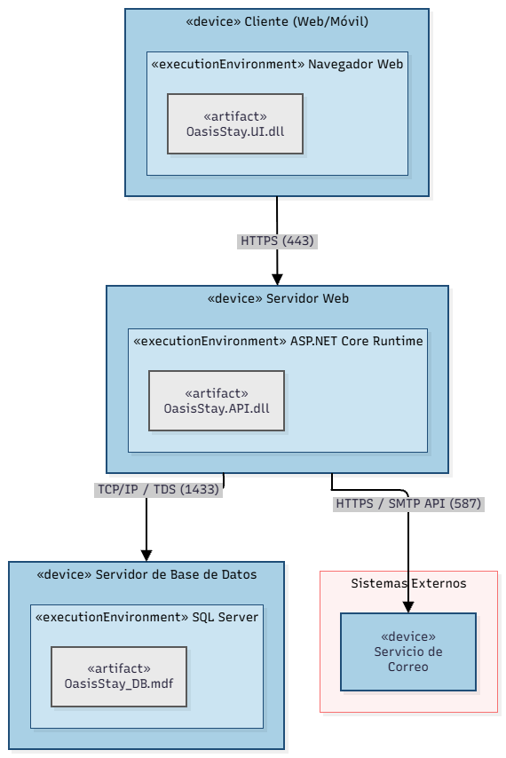

# Diagrama de Despliegue UML — Proyecto Oasis Stay

* **Integrantes:**
  * Luis Miguel Arango Garcia
  * Juan David Jimenez
  * Thomas Muñoz
  * Yeison Cardozo Gomez
  * Simon Herrera Acosta

* **Asignatura:** Diseño de sistemas de información
* **Institución:** Institución Universitaria ITM
* **Fecha:** 13 de Octubre 2026

---

## Fase 1. Análisis de infraestructura sin IA

### 1. Descripción de la arquitectura de despliegue propuesta
La arquitectura de despliegue propuesta para **Oasis Stay** sigue un modelo distribuido basado en la separación de responsabilidades (C4 Nivel 2). La solución divide físicamente el sistema en tres capas principales:

* **Capa de Presentación:** Un servidor web que aloja la aplicación administrativa interactiva.
* **Capa de Negocio:** Un servidor de aplicaciones independiente que aloja la API (Backend), encargado de procesar las reglas de dominio (facturación, reservas, estados).
* **Capa de Datos:** Un servidor de base de datos relacional aislado.

Esta arquitectura garantiza que la carga de trabajo de la interfaz de usuario no interfiera con el procesamiento de las reglas de negocio, permitiendo un manejo eficiente de las integraciones externas (pagos y notificaciones).

### 2. Tecnologías seleccionadas y justificación
* **Frontend (Aplicación Administrativa):** Kestrel Server (ASP.NET Core Razor Pages). Requerido nativamente para renderizar las vistas antes de enviarlas al cliente.
* **Backend (API de Negocio):** Kestrel Server (ASP.NET Core Web API). Ofrece alto rendimiento para procesar las reglas de negocio complejas (patrones Strategy, Decorator) y gestionar múltiples peticiones concurrentes.
* **Base de Datos:** SQL Server. Garantiza la consistencia relacional (ACID) esencial para el manejo de facturas y reservas, integrándose perfectamente con Entity Framework Core.
* **Integraciones:** Servicios HTTP/REST. Permite acoplar pasarelas de pago y servicios de correo externos mediante estándares web universales.

### 3. Identificación de nodos, entornos de ejecución y artefactos

| Nodo Físico/Virtual (`«device»` / `«node»`) | Entorno de Ejecución (`«executionEnvironment»`) | Artefacto Desplegado (`«artifact»`) | Descripción de la función |
| :--- | :--- | :--- | :--- |
| **Dispositivo Cliente** | Navegador Web (Chrome, Edge, etc.) | *(Renderiza HTML/CSS/JS)* | Dispositivo utilizado por recepcionistas, administradores o amas de llaves. |
| **Servidor Web (Frontend)** | Runtime de ASP.NET Core 8+ | `OasisStay.UI.dll` | Provee la interfaz gráfica y maneja la interacción del usuario. |
| **Servidor API (Backend)** | Runtime de ASP.NET Core 8+ | `OasisStay.API.dll` | Procesa lógica de negocio, reglas de facturación y coordina base de datos. |
| **Servidor de Base de Datos** | Motor de SQL Server | `OasisStay_DB.mdf` | Almacena reservas, consumos, historial y estados de habitaciones. |
| **Sistemas Externos** | Infraestructura del Proveedor | N/A | Pasarela de pagos externa y proveedor de mensajería/correo. |

### 4. Rutas de comunicación, protocolos y puertos
* **Cliente web → Servidor Web (Frontend):** Protocolo: `HTTPS` | Puerto: `443`
* **Servidor Web (Frontend) → Servidor API (Backend):** Protocolo: `HTTPS (REST/JSON)` | Puerto: `443`
* **Servidor API (Backend) → Servidor de Base de Datos:** Protocolo: `TCP/IP (TDS)` | Puerto: `1433`
* **Servidor API (Backend) → Sistemas Externos (Pagos/Notificaciones):** Protocolo: `HTTPS (API REST)` | Puerto: `443`

### 5. Diagrama de despliegue inicial sin IA

🔗 [Ver Diagrama Inicial en Google Drive](https://drive.google.com/file/d/17EOFGQVWZWEcywxbEjDO0Vk2vNE_x7cO/view?usp=sharing)

---

## Fase 2. Auditoría con IA

### 6. Prompt utilizado y respuesta de la IA

> **Prompt utilizado:**  
> *"Actúa como un Arquitecto de Software Senior. He diseñado un diagrama de despliegue inicial para un sistema hotelero (Oasis Stay) construido en ASP.NET Core (Razor Pages para UI y Web API para Backend) con SQL Server. Mi arquitectura tiene: 1 servidor cliente que se conecta por HTTPS al Frontend, el Frontend se conecta por HTTPS a la API, y la API va a SQL Server por el puerto TCP 1433. La API también consume servicios de pagos y notificaciones por HTTPS. Por favor, evalúa críticamente este diagrama considerando la coherencia de los nodos, seguridad, disponibilidad, posibles puntos únicos de fallo y capacidad de crecimiento."*

**Resumen de la Respuesta de la IA:**
* **Puntos Únicos de Fallo:** Contar con un solo nodo para Frontend y otro para Backend representa un riesgo. Recomienda usar un Balanceador de Carga.
* **Seguridad Perimetral:** Desaconseja exponer el servidor Kestrel directamente a internet. Sugiere interponer un Proxy Inverso.
* **Escalabilidad de BD:** Sugiere migrar el servidor de bases de datos tradicional a un servicio gestionado (PaaS) en la nube.
* **Acoplamiento de red:** Sugiere usar un Message Broker (colas de mensajes como RabbitMQ) para manejar las notificaciones a sistemas externos.

---

## Fase 3. Validación de recomendaciones

### 7. Tabla de auditoría con hallazgos, decisiones y justificaciones

| Hallazgo / Recomendación de IA | Decisión | Justificación Técnica (Alcance del Proyecto) |
| :--- | :--- | :--- |
| **Punto único de fallo:** Agregar balanceador de carga y réplicas para los nodos de UI y API. | **ACEPTAR** | La disponibilidad es crítica en la operación de un hotel (24/7). Se agregará un Balanceador de Carga en la entrada para distribuir el tráfico hacia múltiples instancias, garantizando tolerancia a fallos. |
| **Seguridad:** Implementar un Proxy Inverso para proteger los servidores web. | **ACEPTAR** | Es una buena práctica en arquitecturas .NET no exponer el servidor Kestrel directamente a la red pública. El Balanceador de Carga actuará simultáneamente como Proxy Inverso. |
| **Servicios Externos:** Implementar un Message Broker (como RabbitMQ) para el manejo de notificaciones y correos. | **RECHAZAR** | Representa sobreingeniería tecnológica para el alcance actual (MVP). El envío de confirmaciones y correos se gestionará de manera asíncrona a nivel de código (mediante `Task`) sin necesidad de incorporar infraestructura adicional que incremente costos y mantenimiento. |
| **Base de Datos:** Usar un servicio relacional gestionado (PaaS/Cloud) en lugar de un nodo de servidor virtual tradicional. | **ACEPTAR** | Se opta por alojar SQL Server como un servicio administrado en la nube (Ej. Azure SQL Database) para delegar las tareas operativas como mantenimiento de sistema operativo, redundancia y copias de seguridad automatizadas. |

---

## Fase 4. Refinamiento del despliegue

### 8. Análisis de los atributos de calidad y principales riesgos del despliegue
* **Disponibilidad:** Mejorada drásticamente en el diseño final gracias al uso de un Balanceador de Carga y la base de datos gestionada en la nube (PaaS).
* **Seguridad:** Toda la comunicación entre nodos está cifrada (`HTTPS`). La capa de base de datos se mantiene en una red privada virtual y solo admite conexiones de la IP del servidor API.
* **Escalabilidad:** Al estar la UI separada de la API, el hotel puede escalar horizontalmente las capacidades del servidor Backend si procesos complejos de facturación consumen excesivos recursos.
* **Principales Riesgos:** Una caída del proveedor de la Pasarela de Pagos afectará el check-out. Esto debe mitigarse en el software permitiendo registrar pagos manuales en efectivo.

### 9. Conclusiones sobre la viabilidad de la infraestructura
El diseño de infraestructura propuesto para el MVP de **Oasis Stay** es completamente viable y conecta perfectamente con el trabajo de la entrega anterior (componentes y patrones GoF). Se evitó la incorporación de tecnologías complejas e innecesarias (como colas de mensajería externas), optando por un despliegue en la nube que soluciona los problemas de seguridad y alta disponibilidad sin exceder el presupuesto y la capacidad operativa del proyecto.