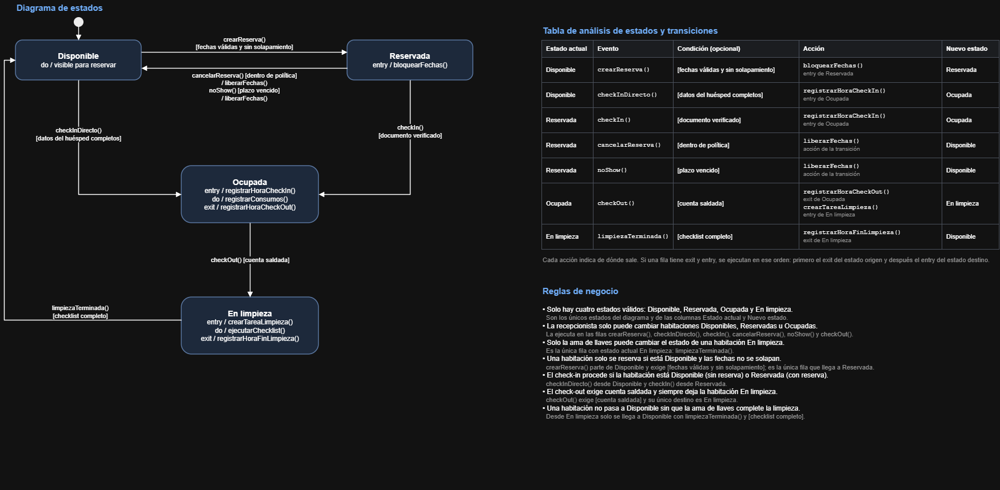

# DIAGRAMA DE ESTADOS #1 (DISPONIBILIDAD HABITACIÓN DE HOTEL)

**Descripcion:** Este ejemplo esta basado en el sistema de hotel elaborado por nosotros, el cual tiene como objetivo principal la correcta funcionalidad de reservas en Oasis Stay, teniendo varios tipos de estados caracteristicos de las habitaciones como: Disponible, Reservada, Ocupada y en limpieza.

Enlace al diagrama: <https://n9.cl/w6pom>

## 4. Validación del modelo

### Escenario 1: Transición válida (ciclo completo con reserva el mismo día)

**Situación:** La habitación 205 está ocupada por un huésped que sale hoy. El recepcionista le hace el check-out y, como la habitación ya tiene una reserva para esa misma noche, debe quedar lista para el siguiente huésped.

| Paso | Estado actual | Evento | Condición | Acción ejecutada | Nuevo estado |
|---|---|---|---|---|---|
| 1 | Ocupada | `checkOut()` | Cuenta saldada (se cumple) | `crearTareaLimpieza()` | En limpieza |
| 2 | En limpieza | `limpiezaTerminada()` | Checklist completo y con reserva hoy (se cumple) | `registrarFinLimpieza()` | Reservada |

**Resultado esperado:** La habitación pasa de *Ocupada* a *En limpieza* y luego a *Reservada*, sin quedar disponible para otros huéspedes. Se genera la tarea para el ama de llaves, se registra la hora de check-out y la hora de fin de limpieza.

**Conclusión:** Ambas transiciones existen en el diagrama y sus condiciones se cumplen, por lo tanto el cambio de estado es válido.

---

### Escenario 2: Transición no permitida (check-in con la habitación en limpieza)

**Situación:** La habitación 310 está en estado *En limpieza*. Llega un huésped sin reserva y el recepcionista intenta hacer un `checkInDirecto()` con todos los datos completos.

| Estado actual | Evento | Condición | Resultado |
|---|---|---|---|
| En limpieza | `checkInDirecto()` | Datos del huésped completos | **No permitido** |

**Resultado esperado:** El sistema rechaza el evento y la habitación **permanece en *En limpieza***. No se ejecuta `registrarIngreso()` y se informa al recepcionista que la habitación aún no está disponible.

**Justificación:** En el diagrama, el evento `checkInDirecto()` solo está definido desde el estado *Disponible*. Desde *En limpieza* únicamente existe la transición `limpiezaTerminada()` (hacia *Disponible* o *Reservada*). Además, esto respeta la regla de negocio de que una habitación no puede ocuparse si no ha terminado su limpieza.

---