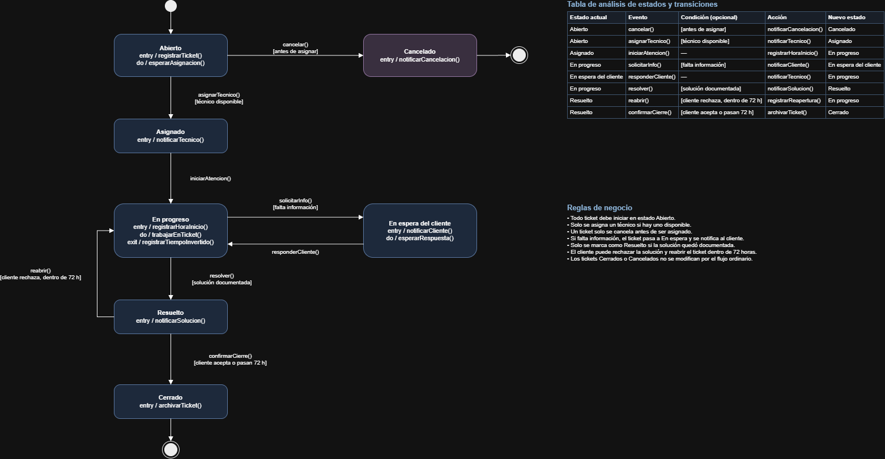
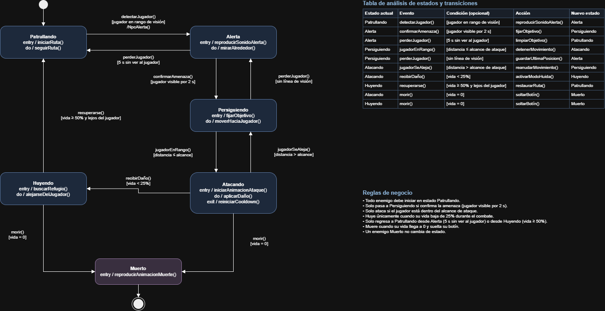
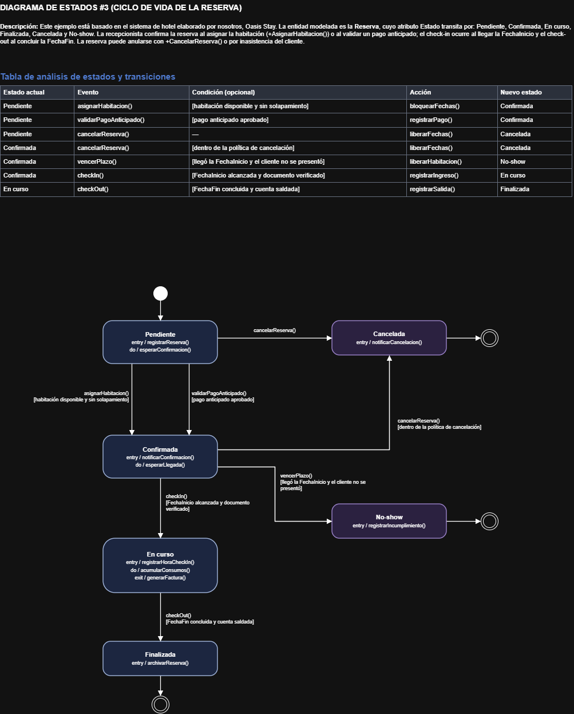

# DIAGRAMA DE ESTADOS #1 (DISPONIBILIDAD HABITACIÓN DE HOTEL)

**Descripcion:** Este ejemplo esta basado en el sistema de hotel elaborado por nosotros, el cual tiene como objetivo principal la correcta funcionalidad de reservas en Oasis Stay, teniendo varios tipos de estados caracteristicos de las habitaciones como: Disponible, Reservada, Ocupada y en limpieza.

Enlace al diagrama: <https://n9.cl/w6pom>

## 4. Validación del modelo

### Escenario 1: Transición válida (ciclo completo con reserva el mismo día)

**Situación:** La habitación 205 está ocupada por un huésped que sale hoy. El recepcionista le hace el check-out y, como la habitación ya tiene una reserva para esa misma noche, debe quedar lista para el siguiente huésped.

| Paso | Estado actual | Evento | Condición | Acción ejecutada | Nuevo estado |
|---|---|---|---|---|---|
| 1 | Ocupada | `checkOut()` | Cuenta saldada (se cumple) | `crearTareaLimpieza()` | En limpieza |
| 2 | En limpieza | `limpiezaTerminada()` | Checklist completo y con reserva hoy (se cumple) | `registrarFinLimpieza()` | Reservada |

**Resultado esperado:** La habitación pasa de *Ocupada* a *En limpieza* y luego a *Reservada*, sin quedar disponible para otros huéspedes. Se genera la tarea para el ama de llaves, se registra la hora de check-out y la hora de fin de limpieza.

**Conclusión:** Ambas transiciones existen en el diagrama y sus condiciones se cumplen, por lo tanto el cambio de estado es válido.

---

### Escenario 2: Transición no permitida (check-in con la habitación en limpieza)

**Situación:** La habitación 310 está en estado *En limpieza*. Llega un huésped sin reserva y el recepcionista intenta hacer un `checkInDirecto()` con todos los datos completos.

| Estado actual | Evento | Condición | Resultado |
|---|---|---|---|
| En limpieza | `checkInDirecto()` | Datos del huésped completos | **No permitido** |

**Resultado esperado:** El sistema rechaza el evento y la habitación **permanece en *En limpieza***. No se ejecuta `registrarIngreso()` y se informa al recepcionista que la habitación aún no está disponible.

**Justificación:** En el diagrama, el evento `checkInDirecto()` solo está definido desde el estado *Disponible*. Desde *En limpieza* únicamente existe la transición `limpiezaTerminada()` (hacia *Disponible* o *Reservada*). Además, esto respeta la regla de negocio de que una habitación no puede ocuparse si no ha terminado su limpieza.

---

# DIAGRAMA DE ESTADOS #2 (TICKET DE SOPORTE TÉCNICO)

**Descripción:** Una empresa de software tiene un sistema de mesa de ayuda (*help desk*), donde los clientes reportan problemas, como “no puedo iniciar sesión” o “la factura sale mal”. El sistema registra cada reporte, lo asigna a un técnico y hace seguimiento hasta resolverlo.

La entidad modelada es el Ticket, que es cada reporte individual. Su ciclo de vida es: se crea, se asigna, se trabaja, se resuelve y se cierra, o se cancela antes de empezar.

Enlace al diagrama: <https://n9.cl/g9xnfq>

## 4. Validación del modelo

### Escenario 1: Transición válida (ticket resuelto con una pausa por falta de información)

**Situación:** Un cliente reporta que no puede iniciar sesión. El ticket #482 se asigna a un técnico, quien necesita un dato adicional y debe esperar la respuesta del cliente antes de resolverlo.

| Paso | Estado actual | Evento | Condición | Acción ejecutada | Nuevo estado |
|---|---|---|---|---|---|
| 1 | Abierto | `asignarTecnico()` | Técnico disponible (se cumple) | `notificarTecnico()` | Asignado |
| 2 | Asignado | `iniciarAtencion()` | — | `registrarHoraInicio()` | En progreso |
| 3 | En progreso | `solicitarInfo()` | Falta información (se cumple) | `notificarCliente()` | En espera del cliente |
| 4 | En espera del cliente | `responderCliente()` | — | `notificarTecnico()` | En progreso |
| 5 | En progreso | `resolver()` | Solución documentada (se cumple) | `notificarSolucion()` | Resuelto |
| 6 | Resuelto | `confirmarCierre()` | Cliente acepta o pasan 72 h (se cumple) | `archivarTicket()` | Cerrado |

**Resultado esperado:** El ticket recorre Abierto → Asignado → En progreso → En espera del cliente → En progreso → Resuelto → Cerrado. Se notifica al técnico y al cliente en los momentos correspondientes, se registra la hora de inicio y el tiempo invertido (al salir de *En progreso*), y finalmente el ticket queda archivado.

**Conclusión:** Todas las transiciones existen en el diagrama y sus condiciones se cumplen, por lo tanto el flujo es válido.

---

### Escenario 2: Transición no permitida (cancelar un ticket ya asignado)

**Situación:** El ticket #517 ya fue asignado a un técnico. El cliente se arrepiente y solicita cancelarlo, por lo que se intenta ejecutar `cancelar()`.

| Estado actual | Evento | Condición | Resultado |
|---|---|---|---|
| Asignado | `cancelar()` | Antes de asignar (**no se cumple**) | **No permitido** |

**Resultado esperado:** El sistema rechaza la cancelación y el ticket **permanece en *Asignado***. No se ejecuta `notificarCancelacion()` y se informa al usuario que el ticket ya no puede cancelarse porque tiene un técnico a cargo.

**Justificación:** En el diagrama, `cancelar()` solo está definido desde el estado *Abierto* y con la guarda `[antes de asignar]`. Desde *Asignado* la única transición posible es `iniciarAtencion()`. Esto respeta la regla de negocio de que un ticket no puede cancelarse una vez que se le asignó un técnico.

---

### Escenario 3 (opcional): Reapertura fuera de plazo

**Situación:** Un ticket lleva 5 días en estado *Resuelto* y el cliente intenta reabrirlo con `reabrir()`.

| Estado actual | Evento | Condición | Resultado |
|---|---|---|---|
| Resuelto | `reabrir()` | Cliente rechaza, dentro de 72 h (**no se cumple**, pasaron 120 h) | **No permitido** |

**Resultado esperado:** El ticket no vuelve a *En progreso*; al cumplirse las 72 h se ejecuta `confirmarCierre()` y pasa a *Cerrado*. Para continuar, el cliente tendría que abrir un ticket nuevo.

---

# DIAGRAMA DE ESTADOS #3 (VIDEO JUEGO)

**Descripcion:** Una empresa de video juegos tiene un problema muy grave y es que no sabe realmente como plantear los diferentes estados que debe tener un NPC al momento de entrar en contacto con un jugador, y el como reaccione según la situacion que se encuentre despues de dicha interaccion.

Enlace al diagrama: <https://n9.cl/mmtfxc>

## 4. Validación del modelo

### Escenario 1: Transición válida (de patrulla a combate y huida)

**Situación:** Un NPC guardia patrulla una zona. El jugador entra en su rango de visión, el NPC lo confirma como amenaza, lo persigue y lo ataca. Durante el combate el jugador lo hiere y su vida baja al 20 %.

| Paso | Estado actual | Evento | Condición | Acción ejecutada | Nuevo estado |
|---|---|---|---|---|---|
| 1 | Patrullando | `detectarJugador()` | Jugador en rango de visión (se cumple) | `reproducirSonidoAlerta()` | Alerta |
| 2 | Alerta | `confirmarAmenaza()` | Jugador visible por 2 s (se cumple) | `fijarObjetivo()` | Persiguiendo |
| 3 | Persiguiendo | `jugadorEnRango()` | Distancia ≤ alcance de ataque (se cumple) | `detenerMovimiento()` | Atacando |
| 4 | Atacando | `recibirDaño()` | Vida < 25 % (se cumple, vida = 20 %) | `activarModoHuida()` | Huyendo |
| 5 | Huyendo | `recuperarse()` | Vida ≥ 50 % y lejos del jugador (se cumple) | `restaurarRuta()` | Patrullando |

**Resultado esperado:** El NPC recorre Patrullando → Alerta → Persiguiendo → Atacando → Huyendo → Patrullando. En cada estado se ejecutan sus comportamientos `entry`, `do` y `exit` (por ejemplo, `reiniciarCooldown()` al salir de *Atacando*), y al final retoma su ruta original.

**Conclusión:** Todas las transiciones existen en el diagrama y sus condiciones se cumplen, por lo tanto el flujo es válido.

---

### Escenario 2: Transición no permitida (atacar sin haber confirmado la amenaza)

**Situación:** El NPC está en estado *Alerta* porque detectó un ruido. El jugador aparece a 1 metro de distancia y se intenta ejecutar `jugadorEnRango()` para pasar directamente a *Atacando*.

| Estado actual | Evento | Condición | Resultado |
|---|---|---|---|
| Alerta | `jugadorEnRango()` | Distancia ≤ alcance de ataque (se cumple) | **No permitido** |

**Resultado esperado:** El sistema ignora el evento y el NPC **permanece en *Alerta***. No se ejecuta `detenerMovimiento()` y el NPC sigue mirando alrededor hasta que se dé `confirmarAmenaza()` (jugador visible por 2 s) o `perderJugador()`.

**Justificación:** En el diagrama, `jugadorEnRango()` solo está definido desde *Persiguiendo*. Desde *Alerta* únicamente existen `confirmarAmenaza()` y `perderJugador()`. Esto respeta la regla de negocio de que el NPC debe confirmar la amenaza y perseguir al jugador antes de poder atacarlo.

---

### Escenario 3 (opcional): Un NPC muerto no puede reactivarse

**Situación:** El NPC tiene vida = 0 y está en *Muerto*. Un efecto de curación del jugador intenta ejecutar `recuperarse()`.

| Estado actual | Evento | Condición | Resultado |
|---|---|---|---|
| Muerto | `recuperarse()` | Vida ≥ 50 % y lejos del jugador | **No permitido** |

**Resultado esperado:** El NPC permanece en *Muerto* (estado final). No existe ninguna transición de salida desde ese estado.

---

# DIAGRAMA DE ESTADOS #4 (CICLO DE VIDA DE LA RESERVA)

**Descripción:** Este ejemplo está basado en el sistema de hotel elaborado por nosotros, Oasis Stay. La entidad modelada es la **Reserva**, cuyo atributo Estado transita por: Pendiente, Confirmada, En curso, Finalizada, Cancelada y No-show. La recepcionista confirma la reserva al asignar la habitación (+AsignarHabitacion()) o al validar un pago anticipado; el check-in ocurre al llegar la FechaInicio y el check-out al concluir la FechaFin. La reserva puede anularse con +CancelarReserva() o por inasistencia del cliente.

Enlace al diagrama: <https://n9.cl/qrmj8>

## 4. Validación del modelo

### Escenario 1: Transición válida (reserva completa desde la solicitud hasta la salida)

**Situación:** Una huésped solicita una reserva para la habitación 204 del 10 al 12 de diciembre. Se valida su pago anticipado, llega el día de entrada con su documento verificado y, al terminar su estadía, salda la cuenta.

| Paso | Estado actual | Evento | Condición | Acción ejecutada | Nuevo estado |
|---|---|---|---|---|---|
| 1 | Pendiente | `validarPagoAnticipado()` | Pago anticipado aprobado (se cumple) | `registrarPago()` | Confirmada |
| 2 | Confirmada | `checkIn()` | FechaInicio alcanzada y documento verificado (se cumple) | `registrarIngreso()` | En curso |
| 3 | En curso | `checkOut()` | FechaFin concluida y cuenta saldada (se cumple) | `registrarSalida()` | Finalizada |

**Resultado esperado:** La reserva recorre Pendiente → Confirmada → En curso → Finalizada. Se registra el pago, la hora de check-in y los consumos acumulados durante la estadía. Al salir de *En curso* se genera la factura (`exit / generarFactura()`) y, al llegar a *Finalizada*, la reserva se archiva (`entry / archivarReserva()`).

**Conclusión:** Todas las transiciones existen en el diagrama y sus condiciones se cumplen, por lo tanto el flujo es válido.

---

### Escenario 2: Transición no permitida (check-in sin documento verificado)

**Situación:** La reserva está en estado *Confirmada* y el huésped llega el día de entrada, pero no presenta su documento de identidad. El recepcionista intenta ejecutar `checkIn()`.

| Estado actual | Evento | Condición | Resultado |
|---|---|---|---|
| Confirmada | `checkIn()` | FechaInicio alcanzada y documento verificado (**no se cumple**, falta el documento) | **No permitido** |

**Resultado esperado:** El sistema rechaza el check-in y la reserva **permanece en *Confirmada***. No se ejecuta `registrarIngreso()`, no se asigna la habitación como ocupada y se solicita al huésped presentar el documento.

**Justificación:** La transición `checkIn()` solo se dispara si se cumplen ambas partes de la guarda: fecha alcanzada **y** documento verificado. Esto respeta la regla de negocio de que no se puede dar ingreso a un huésped sin verificar su identidad.

---

### Escenario 3 (opcional): Cancelar una reserva que ya está en curso

**Situación:** El huésped ya hizo check-in (la reserva está *En curso*) y quiere cancelar para no pagar el resto de la estadía. Se intenta ejecutar `cancelarReserva()`.

| Estado actual | Evento | Condición | Resultado |
|---|---|---|---|
| En curso | `cancelarReserva()` | Dentro de la política de cancelación | **No permitido** |

**Resultado esperado:** La reserva **permanece en *En curso***. No se ejecuta `liberarFechas()`.

**Justificación:** En el diagrama, `cancelarReserva()` solo existe desde *Pendiente* y *Confirmada*. Desde *En curso* la única salida es `checkOut()`.
