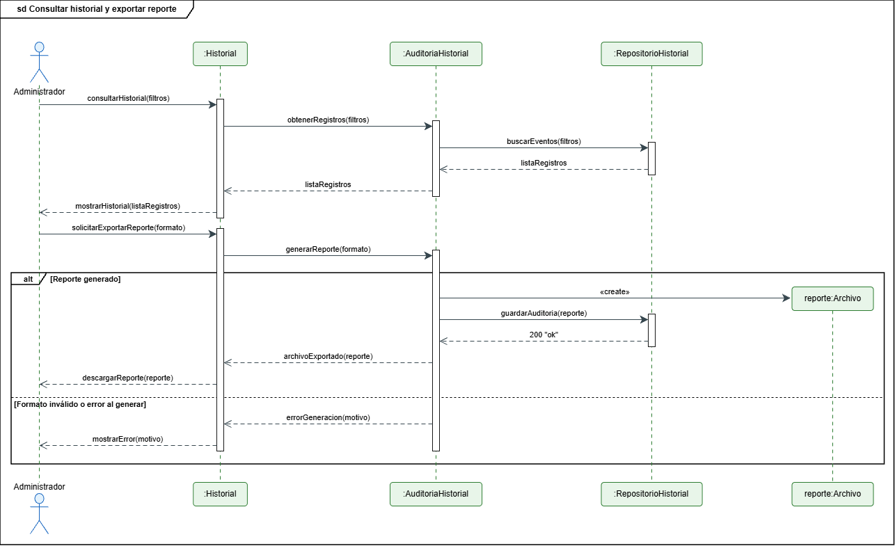
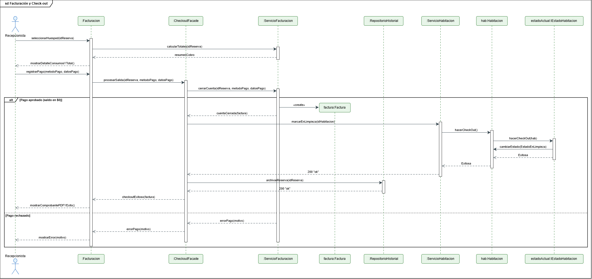
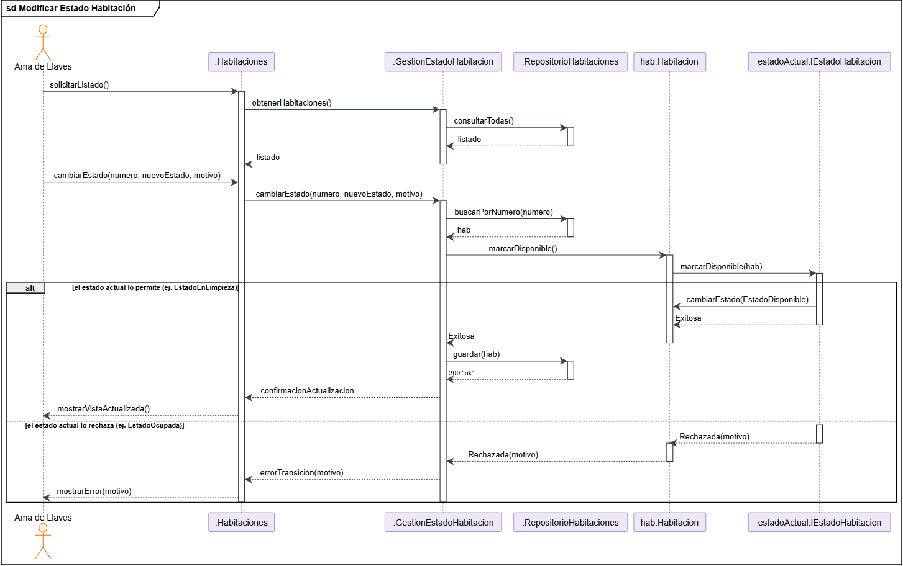
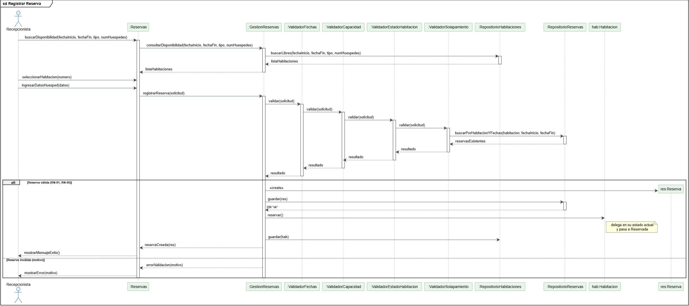
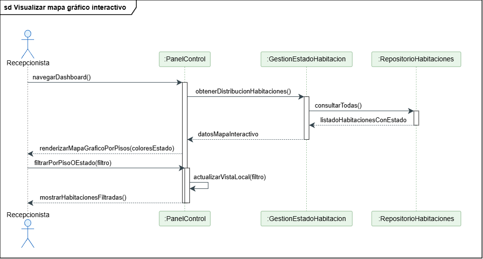

# Diagramas de Secuencia UML — Oasis Stay

Esta carpeta contiene los **5 diagramas de secuencia** del sistema de gestión hotelera **Oasis Stay**, los cuales representan las interacciones entre los actores y los componentes del sistema a lo largo de las épicas principales (`EP-01` a `EP-05`).

## Índice de Diagramas

| # | Épica | Descripción del flujo modelado | Archivo |
| :--- | :--- | :--- | :--- |
| **1** | **EP-01: Auditoría y reportería financiera** | Consulta, consolidación y generación de reportes financieros y registros de auditoría operativa/contable. | `Secuencia3.png` |
| **2** | **EP-02: Facturación, caja y check-out** | Cierre de estadía, liquidación de cargos, generación de factura, movimiento de caja y liberación de habitación. | `Secuencia4.png` |
| **3** | **EP-03: Gestión de habitaciones y disponibilidad** | Consulta de disponibilidad por fechas y administración/actualización de estados de las habitaciones. | `Secuencia2.png` |
| **4** | **EP-04: Gestión de reservas y huéspedes** | Registro y consulta de huéspedes, creación/modificación de reservas y seguimiento de ingreso/estadía. | `Secuencia1.png` |
| **5** | **EP-05: Experiencia de Usuario e Interfaz Front-end** | Interacción del usuario con las vistas, componentes de interfaz y navegación en el sistema. | `Secuencia5.png` |

---

## Detalle y Evidencia Visual

### 1. EP-01: Auditoría y reportería financiera
Modela el flujo de consulta y generación de reportes financieros y trazabilidad de auditoría dentro de **Oasis Stay**.

---

### 2. EP-02: Facturación, caja y check-out
Representa la secuencia de cierre de estadía (`check-out`), emisión de factura, registro en caja y actualización del estado de la habitación.

---

### 3. EP-03: Gestión de habitaciones y disponibilidad
Detalla cómo el sistema consulta la disponibilidad de habitaciones y gestiona su estado operativo.

---

### 4. EP-04: Gestión de reservas y huéspedes
Describe el flujo para registrar/gestionar información de huéspedes y crear o administrar reservas en el sistema.

---

### 5. EP-05: Experiencia de Usuario e Interfaz Front-end
Ilustra la comunicación entre la interfaz front-end, la experiencia de usuario y los servicios/controladores de la aplicación.

