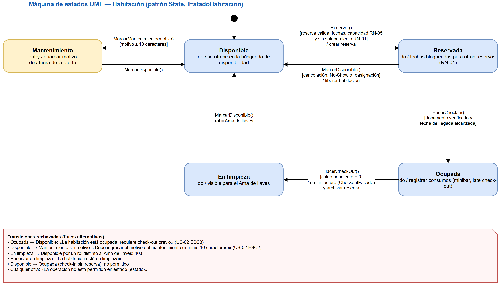

# Máquina de estados UML — Habitación

Enlace editable: <https://n9.cl/4llmh> · Fuente: [`maquinaEstadoHotel.drawio`](maquinaEstadoHotel.drawio)

## Entidad modelada: Habitación

La habitación es la entidad cuyo estado determina qué operaciones permite el hotel: si se puede reservar, recibir al huésped, cobrar su salida o volver a venderse. Su ciclo de vida se implementa con el patrón State: la interfaz IEstadoHabitacion y una clase por estado en Back-end/OasisStay.Dominio/EstadosHabitacion.cs (EstadoDisponible, EstadoReservada, EstadoOcupada, EstadoEnLimpieza y EstadoMantenimiento). El estado inicial es Disponible. No hay estado final, porque el ciclo se repite en cada estadía.

**Tabla 2\. Matriz de análisis de estados y transiciones**

| Estado origen | Evento | Condición de guarda | Acción | Estado destino | Historia |
| :---- | :---- | :---- | :---- | :---- | :---- |
| Disponible | Reservar() | Reserva válida: fechas coherentes, capacidad (RN-05) y sin solapamiento (RN-01) | Crear la reserva y registrar el evento en el historial | Reservada | US-03, US-04 |
| Disponible | MarcarMantenimiento(motivo) | Motivo de al menos 10 caracteres | Guardar el motivo | Mantenimiento | US-02 |
| Reservada | HacerCheckIn() | Documento del huésped verificado y fecha de llegada alcanzada | Registrar el check-in en el historial | Ocupada | US-04 |
| Reservada | MarcarDisponible() (cancelación, No-Show o reasignación) | Cancelación tardía (menos de 24 h): se cobra la primera noche, salvo exoneración del Administrador. No-Show: sin check-in al cierre del día de llegada | Liberar la habitación y registrar el evento | Disponible | US-08, US-04 |
| Ocupada | HacerCheckOut() | Saldo pendiente igual a cero | Emitir la factura (CheckoutFacade) y archivar la reserva | En limpieza | US-06 |
| En limpieza | MarcarDisponible() | El usuario tiene el rol Ama de llaves | Registrar el cambio de estado | Disponible | US-02 |
| Mantenimiento | MarcarDisponible() | — | Registrar el cambio de estado | Disponible | US-02 |

## Explicación técnica de las transiciones y su relación con el MVP

1\. Disponible → Reservada: Reservar()
 La recepcionista registra una reserva. Antes de cambiar el estado, la cadena de validadores (ValidadorFechas, ValidadorCapacidad, ValidadorEstadoHabitacion y ValidadorSolapamiento) comprueba que las fechas sean coherentes, que los huéspedes no superen la capacidad (RN-05) y que no haya otra reserva en esas fechas (RN-01). Funcionalidad del MVP: registro de reservas y consulta de disponibilidad (US-01, US-03, US-04).

2\. Disponible → Mantenimiento: MarcarMantenimiento(motivo)
 La habitación sale de la oferta por una reparación. La guarda exige un motivo de al menos 10 caracteres; si falta, la transición se rechaza con el mensaje "Debe ingresar el motivo del mantenimiento (mínimo 10 caracteres)". Funcionalidad del MVP: cambio de estado de habitación (US-02, figura 5).

3\. Reservada → Ocupada: HacerCheckIn()
 Es el ingreso del huésped con reserva. La guarda exige el documento verificado y que haya llegado la fecha de entrada. El MVP no admite check-in sin reserva: desde Disponible la operación se rechaza. Funcionalidad del MVP: check-in con verificación de documento (US-04).

4\. Reservada → Disponible: MarcarDisponible()
 Hay tres eventos que liberan la habitación: la cancelación (si es tardía se cobra la primera noche, salvo que el Administrador la exonere con un motivo), el No-Show (el huésped no hizo check-in al cierre del día de llegada) y la reasignación a otra habitación. Funcionalidad del MVP: cancelación con penalidad, No-Show y reasignación (US-08, US-04).

5\. Ocupada → En limpieza: HacerCheckOut()
 Se dispara al salir el huésped. La guarda exige saldo pendiente igual a cero. La fachada CheckoutFacade ejecuta en una sola operación el cierre de la cuenta, la emisión de la factura con su folio y PDF, el paso de la habitación a En limpieza y el archivo de la reserva en el historial. Mientras la habitación está Ocupada se registran los consumos (minibar y late check-out) que se cobran en la salida. Funcionalidad del MVP: facturación y check-out (US-05, US-06, US-10).

6\. En limpieza → Disponible: MarcarDisponible()
 Solo el Ama de llaves puede devolver la habitación a la venta después de la limpieza; otro rol recibe el error 403. Funcionalidad del MVP: gestión de limpieza (US-02, figura 4).

7\. Mantenimiento → Disponible: MarcarDisponible()
 Terminada la reparación, la habitación vuelve a la oferta. Funcionalidad del MVP: cambio de estado de habitación (US-02).

### Transiciones rechazadas (flujos alternativos demostrables)

* Ocupada → Disponible: "La habitación está ocupada: requiere check-out previo" (US-02 escenario 3, figura 6).
* Disponible → Mantenimiento sin motivo: "Debe ingresar el motivo del mantenimiento (mínimo 10 caracteres)" (US-02 escenario 2, figura 5).
* Reservar una habitación En limpieza: "La habitación está en limpieza".
* Cualquier otra operación no prevista en el estado actual: "La operación no está permitida en estado {estado}".

### Coherencia con las reglas de negocio

* Hay cinco estados válidos (Disponible, Reservada, Ocupada, En limpieza y Mantenimiento), los mismos de la historia US-02 y del mapa de habitaciones (US-09).
* No hay saltos indebidos: la única forma de llegar a Reservada es Reservar(), la única de llegar a Ocupada es HacerCheckIn() desde Reservada, y la única salida de Ocupada es HacerCheckOut(). Así no se vende una habitación sucia ni se libera una ocupada.
* Cada cambio lo dispara un rol: la recepcionista reserva, hace check-in, cancela y hace check-out; el Ama de llaves cierra la limpieza; el Administrador puede exonerar la penalidad de una cancelación tardía.
* Trazabilidad: cada transición queda registrada en el historial de la reserva, que es de solo inserción (US-07).

### Relación general con el MVP

Cada evento del diagrama es un método de IEstadoHabitacion, y cada clase de estado decide si lo acepta (ResultadoOperacion.Exitosa) o lo rechaza con su motivo (ResultadoOperacion.Rechazada). La API traduce el rechazo en una respuesta 409 y el front muestra el mensaje al usuario. Las pruebas automatizadas CP_H01 a CP_H08 y US02_ESC1 a US02_ESC3 verifican cada transición permitida y rechazada.
